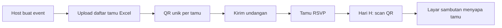
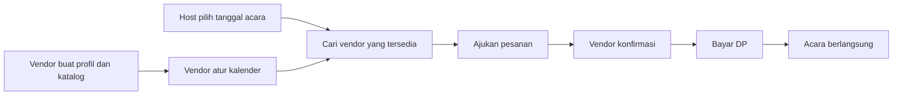

<p align="center">
  
</p>

<p align="center">
  
  
  
  
  
</p>

## Tentang Tamuku

**Tamuku** adalah platform untuk mengelola tamu acara dari undangan sampai hari H. Cocok untuk pernikahan, aqiqah, ulang tahun, seminar, dan acara formal maupun non-formal lainnya.

Bayangkan buku tamu yang hidup: tamu menunjukkan QR, petugas men-scan, dan layar di venue langsung menyapa mereka dengan nama.

> **Selamat datang, Tamu1 Wijaya!**

### Tujuan jangka panjang

Tamuku akan berkembang menjadi **marketplace event**. Penyelenggara bisa mencari dan memesan vendor (gedung, catering, sewa perlengkapan, makeup, penari, dan lainnya), sedangkan vendor mendapat toko dan kalender ketersediaan sendiri, seperti seller di marketplace. Asisten AI bernama **Atha** mendampingi keduanya. Lihat [Marketplace event](#marketplace-event-rencana).

## Fitur

| Fitur | Keterangan |
|---|---|
| Login Google | Daftar dan masuk dengan akun Google (SSO) |
| Daftar tamu dari Excel | Upload daftar tamu, sistem memeriksa email ganda dan baris kosong |
| QR per tamu | Setiap tamu mendapat QR unik berisi token acak, bukan ID berurutan |
| Undangan digital | Pilih template, sebagian gratis dan sebagian berbayar |
| Kirim lewat email | Sekali klik ke semua tamu, dijadwalkan, atau satu per satu |
| RSVP | Tamu konfirmasi hadir dan jumlah orang yang dibawa, sehingga porsi dan merchandise bisa dihitung |
| Peta dan detail lokasi | Link Google Maps, plus keterangan gedung, lantai, dan ruangan |
| Check-in QR | Buku tamu digital yang mencatat waktu kedatangan |
| Layar sambutan | Nama tamu tampil di layar venue, lengkap dengan efek suara |
| Budget dan pengeluaran | Hitung anggaran acara, otomatis menyesuaikan jumlah tamu yang hadir (Premium) |

## Marketplace event (rencana)

Bagian ini baru rencana dan belum dikerjakan. Urutannya ada di [Roadmap](#roadmap).

### Untuk penyelenggara

- Cari vendor menurut kategori, tanggal acara, area, dan anggaran. Hanya vendor yang tersedia di tanggal itu yang ditampilkan.
- Ajukan pesanan, tunggu konfirmasi vendor, lalu bayar DP atau pelunasan.
- Pesanan vendor masuk otomatis ke pengeluaran di fitur Budget.

### Untuk vendor

- Profil usaha dan katalog: kategori, area layanan, foto, paket, dan harga.
- Kalender ketersediaan yang diatur sendiri.
- Terima, tolak, atau konfirmasi pesanan, plus ulasan dari penyelenggara.

Contoh kategori: gedung dan ruang acara, catering, sewa perlengkapan (tenda, kursi, dekorasi, sound system), jasa makeup, penari dan hiburan, serta dokumentasi dan MC.

### Kalender ketersediaan

Penyelenggara memilih tanggal acara, lalu melihat vendor mana yang kosong. Karena jenis vendor berbeda, ada tiga model ketersediaan:

| Model | Contoh | Cara kerja |
|---|---|---|
| Berbasis jadwal (slot waktu) | Makeup, penari, MC, seperti jadwal dokter | Vendor menentukan hari dan jam kerja. Satu slot hanya untuk satu pemesan. |
| Berbasis hari atau sesi | Gedung dan ruang acara | Dipesan per hari atau per sesi, dengan jeda untuk persiapan dan bersih-bersih. |
| Berbasis stok (jumlah unit) | Tenda, kursi, sound system, seperti ketersediaan bed rumah sakit | Tiap pesanan mengurangi sisa unit pada tanggal itu. Pesanan ditolak bila sisa tidak cukup. |

Status tiap tanggal atau slot: tersedia, ditahan sementara, terpesan, dan tidak tersedia. Pemesanan ganda pada waktu yang sama harus dicegah.

### Atha, asisten AI

<p align="center">
  
</p>

**Atha** (Asisten Tata Hajat Andalan) adalah maskot Tamuku sekaligus asisten AI.

- **Untuk penyelenggara:** menjawab pertanyaan penggunaan, menyusun daftar persiapan acara, membantu menulis teks undangan, dan merekomendasikan vendor berdasarkan tanggal, anggaran, jumlah tamu, dan lokasi.
- **Untuk vendor:** membantu menulis deskripsi dan paket layanan, serta menyarankan balasan untuk calon pemesan.

Atha menyarankan, sedangkan keputusan dan pembayaran tetap di tangan pengguna. Atha selalu menyatakan bahwa ia AI, dan rekomendasi berbayar diberi label promosi.

## Cara kerja

Alur penyelenggara dan tamu:



Alur marketplace (rencana):



## Paket

| | Free | Pro | Premium |
|---|:---:|:---:|:---:|
| Event, daftar tamu, RSVP | ✅ | ✅ | ✅ |
| Layar sambutan teks | ✅ | ✅ | ✅ |
| Efek suara dan tema layar | | ✅ | ✅ |
| Template berbayar | | ✅ | ✅ |
| Suara AI dengan nama tamu | | | ✅ |
| Budget dan pengeluaran | | | ✅ |

> Pembagian paket masih rencana dan bisa berubah. Skema untuk vendor dan pembagian fitur Atha per paket belum ditentukan.

## Teknologi

- **Aplikasi web:** Next.js (App Router), TypeScript, Tailwind CSS
- **Database:** PostgreSQL (Neon) dengan Prisma
- **Autentikasi:** Auth.js dengan Google OAuth
- **Real-time layar sambutan:** Server-Sent Events
- **Email:** Resend atau Brevo
- **Hosting:** Vercel
- **Atha (asisten AI):** model AI belum ditentukan

## Roadmap

**Tahap 1 sampai 4: pengelolaan tamu**

- [x] Setup proyek dan halaman depan dengan maskot
- [ ] Skema database (User, Event, Guest, CheckIn)
- [ ] Login Google
- [ ] Buat event dan upload daftar tamu Excel
- [ ] Generate QR per tamu
- [ ] Halaman scan QR
- [ ] Layar sambutan real-time dan satu efek suara
- [ ] Halaman undangan publik dan RSVP
- [ ] Kirim email undangan
- [ ] Template, langganan, dan pembayaran
- [ ] Suara AI, budget tracker, mode offline

**Tahap 5: marketplace dan Atha**

- [ ] Vendor, profil, dan katalog layanan
- [ ] Kalender ketersediaan (jadwal, hari atau sesi, stok)
- [ ] Cari vendor menurut tanggal, kategori, area, dan anggaran
- [ ] Permintaan dan pesanan, termasuk pencegahan pemesanan ganda
- [ ] Pembayaran vendor (DP, pelunasan, komisi)
- [ ] Ulasan dan verifikasi vendor
- [ ] Atha dasar (chat bantuan, daftar persiapan acara)
- [ ] Atha rekomendasi vendor
- [ ] Pesanan vendor masuk ke Budget

## Menjalankan di komputer sendiri

Butuh Node.js (LTS) dan git.

```bash
git clone https://github.com/USERNAME/tamuku.git
cd tamuku
npm install
```

Buat file `.env` di folder utama:

```env
DATABASE_URL="postgresql://..."
AUTH_SECRET="isi-dengan-string-acak"
AUTH_GOOGLE_ID="..."
AUTH_GOOGLE_SECRET="..."
```

Lalu jalankan:

```bash
npx prisma migrate dev
npm run dev
```

Buka [http://localhost:3000](http://localhost:3000).

> Jangan pernah meng-commit file `.env`. File ini berisi kata sandi database dan kunci rahasia.

## Privasi

Tamuku menyimpan nama dan email tamu, jadi data ini diperlakukan sebagai data pribadi. Rencananya, host bisa menghapus data tamu setelah acara selesai. Setelah marketplace hadir, data vendor dan pemesan juga akan diperlakukan sebagai data pribadi sesuai UU PDP.

## Lisensi

Belum ditentukan.

---

<p align="center">Dibuat dengan semangat batik di Medan 🇮🇩</p>
