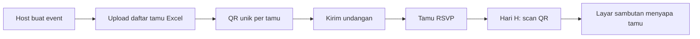

<p align="center">
  
</p>

<p align="center">
  
  
  
  
  
</p>

## Tentang Tamuku

**Tamuku** adalah platform untuk mengelola tamu acara dari undangan sampai hari H. Cocok untuk pernikahan, seminar, ulang tahun, dan acara formal maupun non-formal lainnya.

Bayangkan buku tamu yang hidup: tamu menunjukkan QR, petugas men-scan, dan layar di venue langsung menyapa mereka dengan nama.

> **Selamat datang, Tamu1 Wijaya!**

## Fitur

| Fitur | Keterangan |
|---|---|
| Login Google | Daftar dan masuk dengan akun Google (SSO) |
| Daftar tamu dari Excel | Upload daftar tamu, sistem memeriksa email ganda dan baris kosong |
| QR per tamu | Setiap tamu mendapat QR unik berisi token acak, bukan ID berurutan |
| Undangan digital | Pilih template, sebagian gratis dan sebagian berbayar |
| Kirim lewat email | Sekali klik ke semua tamu, dijadwalkan, atau satu per satu |
| RSVP | Tamu konfirmasi hadir dan jumlah orang yang dibawa, sehingga porsi dan merchandise bisa dihitung |
| Peta dan detail lokasi | Link Google Maps, plus keterangan gedung, lantai, dan ruangan |
| Check-in QR | Buku tamu digital yang mencatat waktu kedatangan |
| Layar sambutan | Nama tamu tampil di layar venue, lengkap dengan efek suara |
| Budget dan pengeluaran | Hitung anggaran acara, otomatis menyesuaikan jumlah tamu yang hadir (Premium) |

## Cara kerja



## Paket

| | Free | Pro | Premium |
|---|:---:|:---:|:---:|
| Event, daftar tamu, RSVP | ✅ | ✅ | ✅ |
| Layar sambutan teks | ✅ | ✅ | ✅ |
| Efek suara dan tema layar | | ✅ | ✅ |
| Template berbayar | | ✅ | ✅ |
| Suara AI dengan nama tamu | | | ✅ |
| Budget dan pengeluaran | | | ✅ |

> Pembagian paket masih rencana dan bisa berubah.

## Teknologi

- **Aplikasi web:** Next.js (App Router), TypeScript, Tailwind CSS
- **Database:** PostgreSQL (Neon) dengan Prisma
- **Autentikasi:** Auth.js dengan Google OAuth
- **Real-time layar sambutan:** Server-Sent Events
- **Email:** Resend atau Brevo
- **Hosting:** Vercel

## Roadmap

- [x] Setup proyek dan halaman depan dengan maskot
- [ ] Skema database (User, Event, Guest, CheckIn)
- [ ] Login Google
- [ ] Buat event dan upload daftar tamu Excel
- [ ] Generate QR per tamu
- [ ] Halaman scan QR
- [ ] Layar sambutan real-time dan satu efek suara
- [ ] Halaman undangan publik dan RSVP
- [ ] Kirim email undangan
- [ ] Template, langganan, dan pembayaran
- [ ] Suara AI, budget tracker, mode offline

## Menjalankan di komputer sendiri

Butuh Node.js (LTS) dan git.

```bash
git clone https://github.com/USERNAME/tamuku.git
cd tamuku
npm install
```

Buat file `.env` di folder utama:

```env
DATABASE_URL="postgresql://..."
AUTH_SECRET="isi-dengan-string-acak"
AUTH_GOOGLE_ID="..."
AUTH_GOOGLE_SECRET="..."
```

Lalu jalankan:

```bash
npx prisma migrate dev
npm run dev
```

Buka [http://localhost:3000](http://localhost:3000).

> Jangan pernah meng-commit file `.env`. File ini berisi kata sandi database dan kunci rahasia.

## Privasi

Tamuku menyimpan nama dan email tamu, jadi data ini diperlakukan sebagai data pribadi. Rencananya, host bisa menghapus data tamu setelah acara selesai.

## Lisensi

Belum ditentukan.

---

<p align="center">Dibuat dengan semangat batik di Medan 🇮🇩</p>
